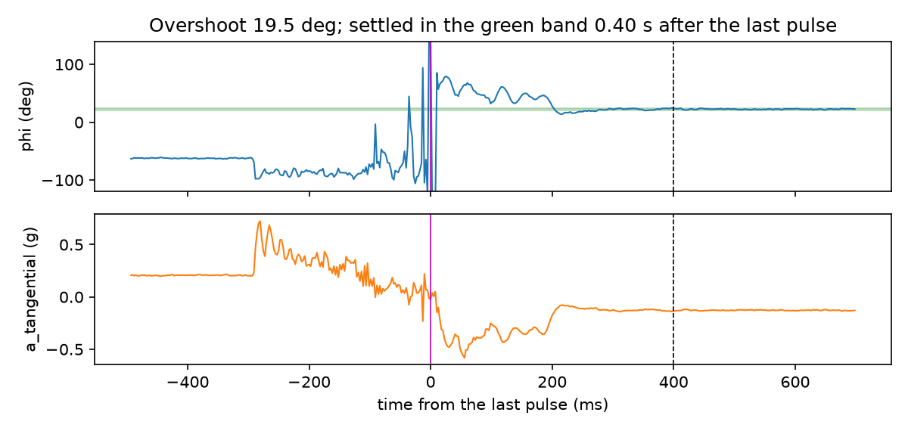
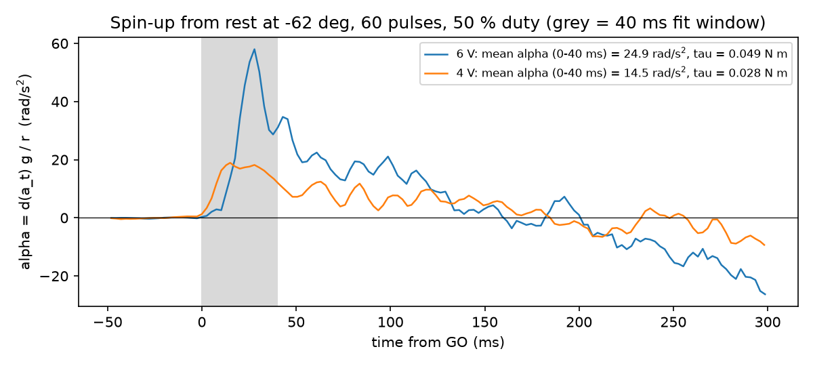

# ECE 437 Lab 8 — Post Lab: H-Bridge Motor Controller

Name: Tong Li   NetID: tongli5   Date of data: 2026-11-03

## Question 1(a): How good is your protractor?

**Question.** *Report the standard deviation of your 100 stationary readings, in degrees. Compare it with the resolution you predicted in the pre lab, and account for any difference.*

**Answer.** The standard deviation of the 100 stationary readings of φ (one every 50 ms) is **0.63°**. The pre-lab
predicted **0.22°** (1 mg ÷ g·sin 15°).

The difference is accelerometer noise. The pre-lab assumed 1 mg, but the measured noise is **2.0 mg (radial)
and 3.0 mg (tangential)**. The measured tilt is β = 14.8°, essentially the assumed 15°. With the measured noise
and β, the same formula predicts **0.66°**, which agrees with the measured 0.63°.

## Question 3(b): Ringing

**Question.** *From a continuous accelerometer log of the arm coming to a stop, report the overshoot and the settling time. Then turn that into a rule: what is the fastest rate at which this rig can make trustworthy stop-and-read position measurements? Give a number in measurements per second.*

**Answer.** Log of a 60-pulse move at 6 V, logged continuously at 400 samples/s:

- **Overshoot: 19.5°** (23 % of an 84.8° move)
- **Settling time: 0.40 s** after the last pulse, until φ stays within ±1.75° of its final value

**Rule.** Each reading takes the settling time plus a 0.25 s average:
1 / (0.40 s + 0.25 s) ≈ **1.5 measurements per second**. The slowest settling time I measured on another move
was 0.62 s, which gives about 1.1 per second, so **about 1 measurement per second** is the safe rate.

## Question 4(a): Torque, with no torque sensor

**Question.** *From a continuous accelerometer log of the arm speeding up from rest, extract the angular acceleration α from the tangential axis. Using the J you computed in the pre lab, report the torque the motor actually produced, in N·m (τ = J·α).*

**Answer.** From rest, the change in the tangential axis is Δa_t = α·r, so α = Δa_t·g / r with r = 0.10 m.
I averaged α over the first 40 ms after GO, before the arm has turned enough for gravity to change a_t. The
pre-lab gives J = 0.3 kg × (0.28 m)² / 12 = 1.96 × 10⁻³ kg·m².

| Log (6 V, from rest) | α | τ = J·α |
|---|---|---|
| ring_20261103_154409 | 29.9 rad/s² | 0.059 N·m |
| 6V_20261103_154455 | 24.9 rad/s² | 0.049 N·m |

**τ ≈ 0.054 ± 0.005 N·m** at 6 V.

## Question 4(c): Torque at two voltages

**Question.** *Repeat 4(a) at two supply voltages. Report both torques and say whether the difference is what you expect, and why.*

**Answer.** Same move from rest at −62°, 60 pulses, 50 % duty:

| Supply | α | **τ** |
|---|---|---|
| 6.0 V | 24.9 rad/s² | **0.049 N·m** |
| 4.0 V | 14.5 rad/s² | **0.028 N·m** |

**Yes, the difference is roughly what I expect.** From rest there is no back-EMF, so the current is V/R and the
motor's torque should scale with voltage: 6/4 = **1.5×**. The measured ratio is **1.7×**. That is a little
higher because the accelerometer sees the **net** torque. A fixed load (gearbox friction and gravity on the
tilted arm) is subtracted from both, so it takes a bigger share at 4 V. Solving τ = kV − τ_load with the two
points gives τ_load ≈ 0.014 N·m.
