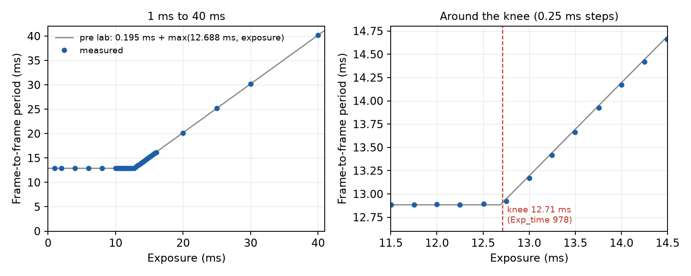

# ECE 437 Lab 9 — Post Lab: CMV300 control plane

Name: Tong Li   NetID: tongli5   Date of data: 2026-11-10

## Question 1: The control plane

**1(b).** *Reading 232 from register 1, and reconstructing 488 from registers 1 and 2, are two different claims about your SPI master. State precisely what each one proves that the other does not.*

- **232:** the bits of one frame are aligned (a one-bit slip reads 208 or 116).
- **488:** two addresses return two different bytes, in the right order.

**1(c).** *Report the temperature registers at the start of your session and after the sensor had been running for several minutes. What does the change tell you, and what would a value that never moved have suggested?*

| When | Raw value |
|---|---|
| Start | **5420** |
| After 309 s | **5468** |

The change: the reading is live and the sensor is running and warming. No change: a constant or stale word.

## Question 2: The clock, and the errata

**2(a).** *Report your three CLK_OUT readings with the register state at each. Compute the percentage error the wrong PLL band would have introduced, and state what that would have done to every number in Milestone 3.*

| Register 69 | Register 83 | CLK_OUT (cycles per ms) |
|---|---|---|
| 0 | 155 | **0** |
| 9 | 155 | **35,344** |
| 9 | 251 | **25,008** |

Error: 35,344 / 25,000 = **41.4 % fast**. Every sensor time would be 0.707 of its value: readout 8.97 ms, pipelined
period 9.1 ms.

**2(b).** *With the wrong band the sensor runs, answers SPI, and produces frames that look reasonable. Explain in two or three sentences why nothing else in this lab would have caught it — and say what that implies about trusting a device that appears to work.*

Nothing else compares CLK_OUT with an independent time base: the row count, pixel count and masks are the same at
any frequency. A device that appears to work is only consistent with itself; it needs an independent measurement.

## Question 3: Two timing regimes

**3(a).** *Report the two times from Milestone 3a and the pipelined period from 3b. Compare each with your pre lab prediction and give the percentage difference. Give the ratio between the single-frame and pipelined periods.*

| Quantity | Measured | Pre lab | Difference |
|---|---|---|---|
| FRAME_REQ to first LVAL | **6.539 ms** | 6.539 ms | 0.0 % |
| First LVAL to last LVAL | **12.688 ms** | 12.688 ms | 0.0 % |
| Pipelined period | **12.883 ms** | 12.883 ms | 0.0 % |

Ratio: 19.227 / 12.883 = **1.49**.

**3(b).** *Explain what pipelining saves, and state clearly what it does not save. Then: one of your two periods answers "how often can I have a frame" and the other answers "how soon can I have one". Say which is which, and name an application that cares about each.*

- Saves: the exposure time. Does not save: the readout or the FOT.
- How often: pipelined, 12.88 ms. Video.
- How soon: single frame, 19.23 ms. Triggered capture.

**3(c).** *Report your three exposure measurements and the exposure at which the period stopped being flat. Explain physically why the period is independent of exposure below that point and proportional to it above.*

| Exposure | Period |
|---|---|
| 1.001 ms | **12.883 ms** |
| 12.753 ms | **12.922 ms** |
| 40.001 ms | **40.170 ms** |

Knee: **12.71 ms**. Below it the exposure fits inside the readout; above it the sensor waits for the exposure.

## Question 4: What the counters revealed

**4(a).** *A row is 324 pixels, one invalid slot, then 324 pixels. Describe exactly what a counter that assumed 648 contiguous valid pixels would report, and say why that number is more dangerous than an error message would have been.*

**649.** It looks like a valid row length, so nothing flags it.

**4(b).** *Report the three deliberate failures from Milestone 3c: which counter revealed each, and what its reading was. Rank them by how quickly you could have identified the cause from that reading alone.*

| Failure | Counter | Reading |
|---|---|---|
| 1. Register 69 cleared | CLK_OUT meter | **0** |
| 2. Number_frames = 0 | Frame counter | **6, 22, 45** at 100, 300, 600 ms (free-running) |
| 3. FRAME_REQ under 1 ms after upload | None | Normal frame, 6 of 6 trials |

Ranking, fastest first: 1, 2, 3.

## Question 5: What you proved without an image

**5(a).** *Report your OR and AND masks in hex at both exposures. For each of these faults, state what the two masks would show: one data line stuck high, one stuck low, and one left unconstrained. Then say what the masks do not prove about the parallel bus.*

| Exposure | OR | AND |
|---|---|---|
| 6.344 ms | **0x3FF** | **0x000** |
| 40.001 ms | **0x3FF** | **0x000** |

- Stuck high: that bit is 1 in AND.
- Stuck low: that bit is 0 in OR.
- Unconstrained: looks stuck, or passes both if it toggles on noise.
- Not proven: line order, shorts between lines, timing margin, correct pixel values.

**5(b).** *List every property of the sensor you established in this lab, and next to each write the single number that established it.*

| Property | Number |
|---|---|
| SPI read | register 1 = 232 |
| Byte order | Number_lines = 488 |
| SPI write | read back 100 |
| Reset restores defaults | register 1 = 232 |
| Sensor live | 5420 → 5468 |
| CLK_OUT gated by register 69 | 0 |
| Default PLL band wrong | 35,344 per ms |
| Correct PLL band | 25,008 per ms |
| Rows per frame | 488 |
| Pixels per row | 648 |
| Exposure + FOT | 6.539 ms |
| Readout | 12.688 ms |
| Pipelined period | 12.883 ms |
| Knee | 12.71 ms |
| Data lines toggle | OR 0x3FF, AND 0x000 |

**5(c).** *FRAME_REQ is the first command in this course that returns nothing. Describe in two or three sentences how you verified something that gives no reply, and name three causes of a bad image you have already ruled out.*

By its effect on the counters: one pulse gave 1 frame, 488 rows, 648 pixels per row and a first LVAL at 6.539 ms.
With no pulse they stayed at 0.

Ruled out: wrong sensor clock, wrong frame geometry, stuck data line.
