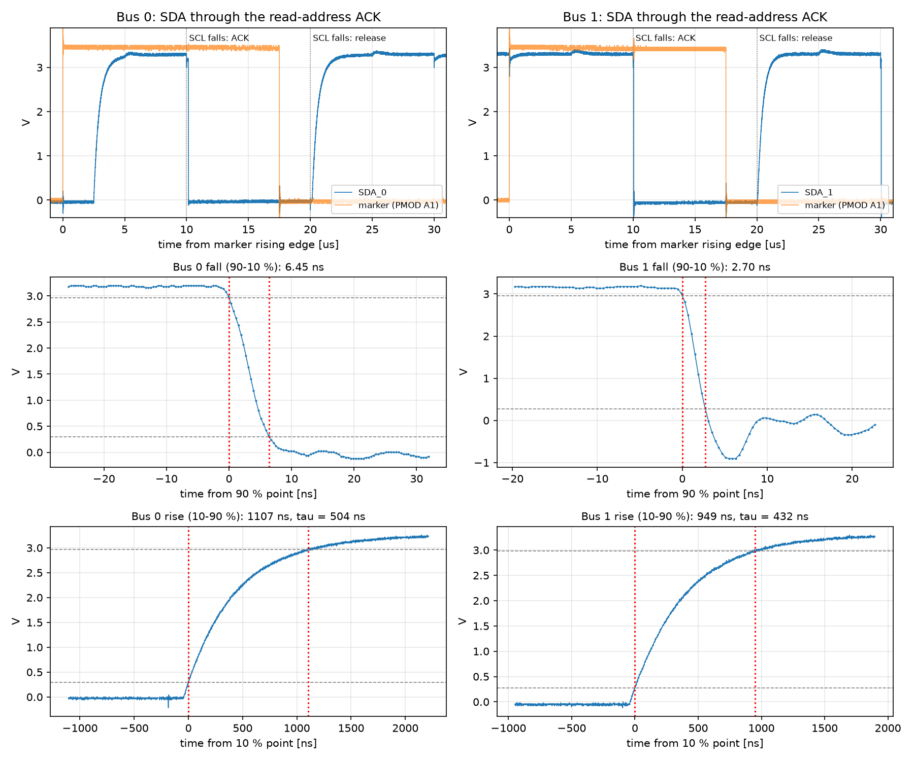
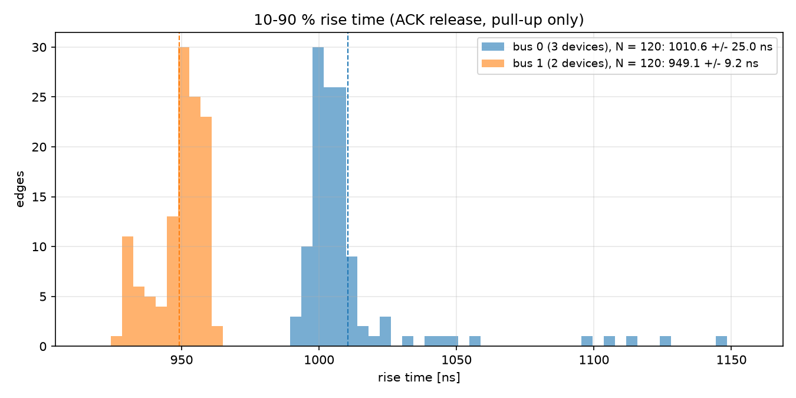
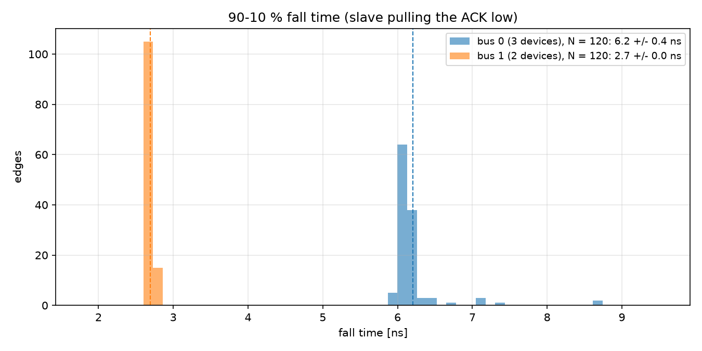

# Midterm Part 2 — Demo Guide

## Results

| | Bus 0 (ADT7420, HTS221, LPS35HW) | Bus 1 (LSM303, AD7156) |
|---|---|---|
| Edges captured | 120 | 120 |
| Rise time, 10–90 % | **1010.6 ± 25.0 ns** | **949.1 ± 9.2 ns** |
| Fall time, 90–10 % | **6.20 ± 0.39 ns** | **2.69 ± 0.03 ns** |
| τ = t_rise / ln 9 | 460 ns | 432 ns |
| Pull-up R (R4–R7) | 10.00 kΩ | 10.00 kΩ |
| **Capacitance C = τ / R** | **46.0 pF** | **43.2 pF** |
| t_r by the I²C spec (30–70 %) = τ·ln(7/3) | 390 ns | 366 ns |
| **Max SCL** (I²C rise-time limits) | **100 kHz, Standard-mode** | **100 kHz, Standard-mode** |

C(bus 0) − C(bus 1) = **2.8 pF**. Neither bus meets Fast-mode (t_r ≤ 300 ns).

## Cheat sheet — run these in order

| # | Command | What to do |
|---|---|---|
| 0 | *(no command)* | Close FrontPanel. Plug the scope into the PC by USB. |
| 1 | *(no command)* | **CH1 tip → SDA_0**, **CH2 tip → PMOD pin 1** (marker). Both ground clips → **PMOD pin 5** (GND). Never clip onto pin 6 or 12 (3.3 V). |
| 2 | `cd U:\ece437\midterm` | — |
| 3 | `py -3.14 midterm_p2_python.py run` | Bus check prints `both buses: PASS`. Press **Enter**, then hands off: 120 edges on bus 0. |
| 4 | *(script asks)* | Move **only the CH1 tip** to **SDA_1**. Leave the grounds and CH2 where they are. Press **Enter**, then hands off: 120 edges on bus 1. |
| 5 | *(automatic)* | Analysis runs and saves the plots and the summary to `results\`. |

Only bus 0 again (probe back on SDA_0): `py -3.14 midterm_p2_python.py capture --bus 0`, then `py -3.14 midterm_p2_python.py analyze`.
Redo the plots from saved data without hardware: `py -3.14 midterm_p2_python.py analyze`.

---

## Before the TA arrives

1. Canvas → **Midterm Part 2** → upload `midterm_p2_python.py`, not zipped, with exactly that name. It must show as submitted.
2. Report 2 goes to the separate **Midterm – Report 2** assignment. It contains no code.
3. Have these open: `results\p2_edge_per_bus.png`, `results\p2_rise_hist.png`, `results\p2_fall_hist.png`, `results\p2_summary.json`.

---

## What the TA checks, in order

### Check 0 — Code is on Canvas

Show the Midterm Part 2 page with `midterm_p2_python.py` submitted.

### Check 1 — How the scope is triggered

**Show:** the scope: trigger source CH2, rising edge, 1.65 V, NORMAL sweep. CH2 is PMOD pin 1.

**Say:** "The trigger is the PMOD marker from my I²C state machine. It goes high at state 110, the last bit of the
read address, which is the state just before the acknowledgment, and stays high through the ACK clock (states
110–116). It is the same bit file and the same state machine on both buses. Only param1 bit 8 changes, which picks
bus 0 or bus 1. So the trigger is the same event on both buses."

**If asked "which edge?":** "Both edges are around the read-address ACK. The **fall** is at about 4 states after the
marker: SCL falls and the slave pulls SDA low to ACK. The **rise** is at about 8 states: SCL falls after the ACK clock
and the slave lets go. Data bit 7 is 1, so only the 10 kΩ pull-up charges the line. I read a register whose bit 7
is 1 on each bus: ADT7420 ID 0xCB on bus 0, and LSM303 CTRL_REG4_A 0x88 on bus 1."

### Check 2 — One captured edge per bus

**Show:** `results\p2_edge_per_bus.png`: the whole ACK on each bus, then zooms on the fall and the rise with the
10 % / 90 % levels.

**Say:** "Rise and fall are computed in Python from the captured array, not from cursors. The 10 % and 90 % levels
are 10 % and 90 % of each edge's own swing. Levels come from flat parts of the bit, and the crossing times are
interpolated between samples. The scope samples every 0.4 ns."

### Check 3 — The two histograms

**Show:** `results\p2_rise_hist.png` and `results\p2_fall_hist.png`. Both buses are on the same bins and axes,
120 edges per bus, each captured and fitted automatically.

| | Bus 0 (ADT7420, HTS221, LPS35HW) | Bus 1 (LSM303, AD7156) |
|---|---|---|
| Edges | 120 | 120 |
| Rise 10–90 % | **1010.6 ± 25.0 ns** | **949.1 ± 9.2 ns** |
| Fall 90–10 % | **6.20 ± 0.39 ns** | **2.69 ± 0.03 ns** |

**Say:** "The rise is slow because only the 10 kΩ pull-up charges the bus capacitance. The fall is about a hundred
times faster because the slave's transistor discharges it. Bus 0 has one more device on it and rises more slowly."

*(If they ask about bus 0's tail: the first ~10 edges, 1100–1145 ns, came right after I pressed Enter, probably the
probe still moving. The rest sit at about 1000 ns. The bus 1 fall rings to −0.9 V because of the probe's ground lead,
and 2.7 ns is close to the scope's own ~1.75 ns rise time, so it is an upper bound.)*

### Check 4 — The two capacitances

The rise is an RC charge: v = Vh − ΔV·e^(−t/τ), so t(10→90 %) = τ·ln 9 = 2.197 τ, and C = τ / R.
The pull-ups are R4–R7 on the schematic, all **10.00 kΩ**.

| | Bus 0 | Bus 1 |
|---|---|---|
| τ = t_rise / ln 9 | 460 ns (log fit 459 ns) | 432 ns (log fit 430 ns) |
| **C = τ / 10.00 kΩ** | **46.0 pF** | **43.2 pF** |

**Difference: C(bus 0) − C(bus 1) = 2.8 pF.**

**Say:** "These numbers are on no datasheet. They are this board's wiring plus the device pins. Both include my 10x
probe (about 10–15 pF), but that is the same on both, so it cancels in the difference. The extra device on bus 0
is worth about 3 pF."

### Check 5 — Maximum SCL each bus permits

The I²C specification (NXP UM10204, Table 10) measures t_r from **30 % to 70 %** of VDD, so
t_r(spec) = τ·ln(7/3) = 0.847 τ:

| | t_r (30–70 %) | Fast-mode Plus ≤ 120 ns | Fast-mode ≤ 300 ns | Standard-mode ≤ 1000 ns | **Max SCL** |
|---|---|---|---|---|---|
| Bus 0 | 390 ns | no | no | yes | **100 kHz** |
| Bus 1 | 366 ns | no | no | yes | **100 kHz** |

**Say:** "Both buses can only run Standard-mode, 100 kHz. Fast-mode needs a rise of 300 ns or less, and mine are 390
and 366 ns. This is set by the board's 10 kΩ pull-ups, not the sensors, which all allow 400 kHz. To reach 400 kHz on
these buses the pull-up would have to be below about 300 ns / (0.847 × 46 pF) ≈ 7.7 kΩ on bus 0 and ≈ 8.2 kΩ on bus 1."

---

## Quick reference

| Item | Value |
|---|---|
| Bit file | Part 1's `SensorBoard_I2C\bitfile\SensorBoard_Top.bit`, no new firmware |
| Bus select | param1[8]: 0 = bus 0, 1 = bus 1 |
| Marker | PMOD_A1 (PMOD pin 1), high for FSM states 110–116 (last read-address bit + ACK), GND = PMOD pin 5 |
| Reads used | bus 0: ADT7420 0x48 reg 0x0B = 0xCB; bus 1: LSM303 0x19 reg 0x23 = 0x88 |
| SCL / state | 100 kHz, one state Ts = 2.5 µs (marker width = 7 Ts, checked on every capture) |
| Scope | MSO-X 3024T, 10x probes, DC, full bandwidth, 32 µs window, 0.4 ns/sample, NORMAL acquisition |
| Pull-ups | R4–R7 = 10.00 kΩ each |
| Files | `results\p2_bus0_raw.npz`, `p2_bus1_raw.npz` (raw scope codes), `p2_edges.csv`, `p2_summary.json`, 3 PNGs |
