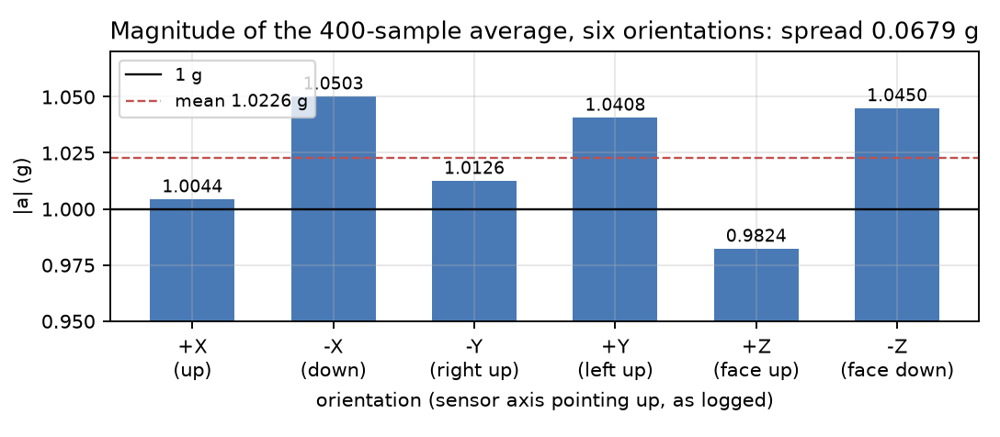
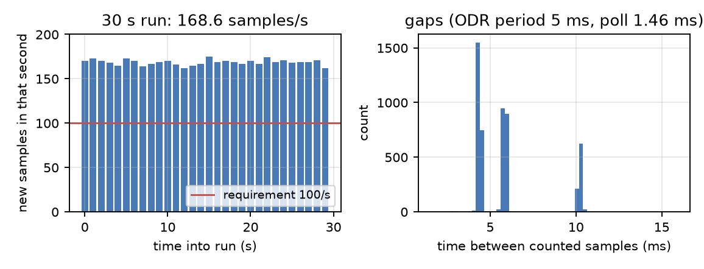
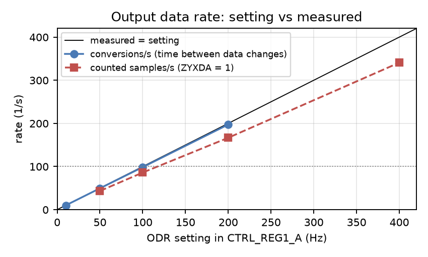

# ECE 437 Midterm — Report 1: The Sensor (LSM303DLHC accelerometer)

Name: Tong Li   NetID: tongli5   Lab partner: ______________________  Date of data: 2026-10-19

All numbers in this report come from files in `midterm/results/`. Each answer names its file. The
datasheet is LSM303DLHC Doc ID 018771 Rev 1; page and table numbers refer to it.

## I²C state machine used, and what changed

I used the **Lab 6 generated state machine**. In Lab 6 it already did a complete one-byte register read:
S, addr+W, A, pointer, A, Sr, addr+R, A, data, NACK, P. It runs one state per quarter SCL bit from a single
100.8 MHz clock enable, and drives the bus open-drain. I chose it over my Lab 5 machine for three reasons:

- it has a scripted build (`build.sh`);
- it has a simulation testbench with a behavioural I²C slave, which I could extend to model the LSM303;
- its top level already handles both I²C buses, and the LSM303 is on **bus 1**, not bus 0 where the ADT7420 is.

Changes made to talk to a different device on a different bus (`midterm_p1_i2c.v`, `SensorBoard_Top.v`):

| Change | Why |
|---|---|
| Multi-byte read: master ACK (MAK) after every byte except the last, 1–8 bytes per transaction (`param3[7:4]`) | Six output bytes in one burst (Table 15 p.20) |
| Register-write path: S, addr+W, A, SUB, A, DATA, A, P (`param3[1]`, data in `param2[15:8]`) | The accelerometer powers up in power-down mode and must be configured |
| SUB byte sent exactly as given by the host | Auto-increment is SUB(7); the deliberate fault is a 1-bit host change |
| 64-bit result: bytes 0–3 on WireOut 0x21, bytes 4–7 on new WireOut 0x24 | Seven data bytes per poll |
| Transaction counter on WireOut 0x25 | Python checks that one trigger gives exactly one transaction |
| Run-time SCL divide (`param3[31:16]`, default 252 = 100 kHz) | For Part 2 |
| Scope marker on PMOD A1 (read-address ACK window), busy on PMOD A2 | Lab 7 marker, for Part 2 |
| Bus select `param1[8] = 1`, address bytes 0x32/0x33 (accelerometer), 0x3C/0x3D (magnetometer) | LSM303 is on I²C bus 1 |

Verification before hardware: the xsim testbench (47 checks, all pass) uses a slave model that follows the ST
SUB(7) rule. It checks the register write and read-back, 6-, 7- and 8-byte bursts, the burst with SUB(7)
cleared (every byte = OUT_X_L_A), and 400 kHz operation.

Sensor configuration used for all of Part 1:

| Register | Value | Meaning |
|---|---|---|
| CTRL_REG1_A (0x20) | 0x67 | ODR = 200 Hz, normal mode, X/Y/Z enabled |
| CTRL_REG4_A (0x23) | 0x88 | BDU = 1, BLE = 0 (little-endian), FS = ±2 g, HR = 1 (12-bit) |

**Full scale ±2 g, scale factor 1 mg/LSB** (Table 3 p.9). The 16-bit two's-complement word is left-justified
12-bit data, so `a [g] = (int16(H:L) >> 4) × 1 mg`. The conversion was checked against hand-made vectors, e.g.
`0x3E80 → +1.000 g` and `0xC180 → −1.000 g`, before any hardware was used.

---

## Question 1: The gravity table

### 1a. Six-orientation table

Each row is the average of 400 new conversions (ZYXDA-gated, about 2.4 s), with the board resting on the bench.
"Gravity axis" is the sensor axis that read about ±1 g, and its sign. The description is what I typed at the time.
Source: `six_orientations.csv`, `six_summary.json`, raw samples in `six_raw_samples.csv`.

| # | Board position (as logged) | Axis | ax (g) | ay (g) | az (g) | \|a\| (g) | per-sample std x / y / z (g) |
|---|---|---|---|---|---|---|---|
| 1 | up | +X | +1.0041 | −0.0040 | −0.0258 | **1.0044** | 0.005 / 0.003 / 0.004 |
| 2 | down | −X | −1.0424 | +0.0328 | −0.1241 | **1.0503** | 0.010 / 0.010 / 0.013 |
| 3 | right up | −Y | −0.0405 | −1.0096 | −0.0669 | **1.0126** | 0.004 / 0.005 / 0.006 |
| 4 | left up | +Y | +0.0439 | +1.0397 | +0.0154 | **1.0408** | 0.004 / 0.003 / 0.004 |
| 5 | face up | +Z | +0.0273 | +0.0577 | +0.9803 | **0.9824** | 0.012 / 0.005 / 0.009 |
| 6 | face down | −Z | +0.1590 | −0.0133 | −1.0328 | **1.0450** | 0.003 / 0.003 / 0.004 |

### 1b. Spread and mean

- **Spread of |a| (max − min) = 1.0503 − 0.9824 = 0.0679 g**, under the 0.15 g acceptance limit.
- **Mean |a| = 1.0226 g.**

### 1c. Which physical direction each axis points

At rest, an accelerometer measures the force that holds it up, so the axis pointing **up** (away from the
Earth) reads **+1 g**. I found the mapping from the table, not from the datasheet drawing:

- **Z:** reads +0.98 g with the component side up (row 5) and −1.03 g with it down (row 6). **+Z points out of the
  component side** of the board.
- **X:** reads +1.00 g in the orientation I logged as "up" (row 1) and −1.04 g in "down" (row 2). **+X points
  toward the board edge that was on top in the "up" position.**
- **Y:** reads +1.04 g with the left edge up (row 4) and −1.01 g with the right edge up (row 3). **+Y points
  toward the board's left edge** (component side facing me).

Method: in each orientation exactly one axis is near ±1 g and the other two are near 0. That axis is the one
along gravity, and its sign says whether it points up or down. Each axis was seen in both directions, and
the ± readings are near mirror images, so this is not a stuck or swapped channel.

Check: the result must be a right-handed set. With the component side facing me, X toward the top edge,
Y toward the left, X × Y points out of the board, which is +Z, as measured. The live tilt run (`live_tilt.csv`, 221
readings while I turned the board by hand) swept each axis through about ±1 g: ax −1.09…+1.46 g, az −1.16…+0.21 g.
Peaks above 1 g are my hand accelerating the board.

### 1d. Zero-g offset

The datasheet gives a **typical zero-g level offset of ±60 mg** (LA_TyOff, Table 3 p.10, FS = ±2 g).

How much spread can the offset alone produce? Let axis *i* read `true + o_i`. With gravity along +*i*, that
axis reads 1 + o_i and the other two read only their small offsets. Those add in quadrature (≈ o²/2, under
2 mg), so |a| ≈ 1 + o_i. Turned over, |a| ≈ 1 − o_i. A pair of opposite orientations therefore differs by
**2|o_i|**, and across all six:

- **Datasheet worst case:** spread ≈ (1 + 0.060) − (1 − 0.060) = **0.120 g**.
- **Measured:** **0.068 g**, which is within what the offset alone could produce.

My own board's offsets: I fitted an offset and a sensitivity for each axis to the six averaged vectors. The
fit uses the full vectors, so the board's tilt does not bias it. Source: `six_fit.json`. Six equations and
six unknowns make it an exact solve, not a test, but it shows where the spread comes from:

| Axis | Offset (mg) | Sensitivity (relative to 1 mg/LSB) |
|---|---|---|
| X | −21 | 1.025 |
| Y | +16 | 1.027 |
| Z | −33 | 1.016 |

All three offsets are within the ±60 mg typical. The largest, Z at −33 mg, alone predicts a ±Z pair difference
of 2 × 33 = 67 mg. Measured: 1.0450 − 0.9824 = 68 mg. That pair sets the whole spread. The other pairs differ by
2 × 21 = 42 mg (X, measured 46 mg) and 2 × 16 = 33 mg (Y, measured 28 mg).

**Conclusion:** the spread is the uncalibrated zero-g offset, mostly the Z axis.

The sensitivity is about 2% high on all three axes. That is why the **mean** is 1.023 g rather than 1.000 g,
but because it is similar on all three axes it adds little to the **spread**. The axes differ by at most 1.1%,
about 11 mg.

### 1e. Other contributors (bench level, averaging, rest)

The spread does not need another cause, but I checked the three suggested ones:

- **Bench level / tilt.** The board was not perfectly aligned. In row 6 ax = +0.159 g, so it sat about 8.8° off
  vertical; row 2 was about 7.0° off (resting on connectors and headers on its edges). Tilt moves gravity
  between axes but does not change |a| when the axes have equal gain. Row 6 still gives |a| = 1.045 g, exactly
  what the Z offset predicts. Tilt matters for 1c (which axis is vertical), not for the spread. The only effect
  is second order: 1.1% gain difference × sin²(9°) ≈ 0.3 mg.
- **Averaging length.** Per-sample noise is 3–13 mg. With 400 independent samples the standard error of each
  mean is at most 13 mg / √400 = 0.65 mg, about 1% of the spread. Averaging longer would not change the table.
- **Truly at rest.** Rows 2 and 5 have a larger per-sample std (10–13 mg against 3–5 mg elsewhere), so the board
  was slightly less steady there (balanced on an edge / just let go). Motion adds no bias to the average
  magnitude, though: the mean of the per-sample |a| equals |mean vector| to within 0.13 mg in every row
  (`mean_of_sample_mag_g` in `six_orientations.csv`). So motion did not inflate the spread either.

### 1f. Deliberately broken: SUB(7) cleared

The fault: the same 6-byte burst read with SUB = **0x28** instead of **0xA8**, nothing else changed.
Two orientations were taken; each was read correctly (0xA8) first and then with the fault.
Source: `broken_autoinc.json`.

| Orientation | Read | ax (g) | ay (g) | az (g) | \|a\| (g) | Bytes on the bus (first read) |
|---|---|---|---|---|---|---|
| +X up | correct, SUB 0xA8 | +1.0020 | −0.0080 | −0.0320 | 1.0026 | C0 3E C0 FF 60 FE |
| +X up | **broken, SUB 0x28** | **−0.7550** | **−0.7550** | **−0.7550** | **1.3077** | C0 D0 D0 D0 D0 D0 |
| −Z (face down) | correct, SUB 0xA8 | +0.1127 | −0.0008 | −1.0392 | 1.0453 | 80 06 00 00 60 BF |
| −Z (face down) | **broken, SUB 0x28** | **−1.0171** | **−1.0171** | **−1.0171** | **1.7617** | 80 80 80 80 80 80 |

**Signature (one sentence):** with auto-increment off, the register pointer never leaves OUT_X_L_A (0x28), so
all six bytes are the X low byte. All three axes report the **same** number, |a| is exactly **√3 × |ax|**, and
the value has nothing to do with the orientation (the +X-up board reads −0.755 g on every axis).

**The arithmetic predicts it exactly.** In 12-bit high-resolution mode the low byte is `0xN0`: the 4 LSBs of
the 12-bit result in its top nibble, with the bottom nibble always 0. Assembling L = H = `0xN0` gives the
16-bit word `0xN0N0`, and `>> 4` gives `0xN0N` as a 12-bit two's-complement value, i.e.
**a = N × 257 − 4096·[N ≥ 8] mg**:

- `XL = 0xD0` (N = 13): 13 × 257 − 4096 = **−755 mg**. Measured −0.7550 g on all three axes.
- `XL = 0xC0` (N = 12): 12 × 257 − 4096 = **−1012 mg**.
- `XL = 0x80` (N = 8): 8 × 257 − 4096 = **−2040 mg**.

  The −Z run read 0x80 once and 0xC0 for the other 199 reads. The mean is
  −1.012 − (2.040 − 1.012)/200 = **−1.0171 g** and the std is 1.028·√(1/200 · 199/200) = **0.073 g**,
  both as measured.
- |a| / |ax| = 1.73204 and 1.73205 measured; √3 = 1.73205.

So the broken read can produce only 16 possible values, set by the 4 least significant bits of X.

Two further details in the data, both explained by settings I chose:

1. **The value freezes.** After the first read the broken value stayed constant (std 0.07 mg in the +X run). With
   BDU = 1 an output pair is not updated until its high byte has been read, and the broken read never reads
   OUT_X_H_A. The fault therefore also removes the noise, which is a second giveaway.
2. **The first broken read of the +X run was `C0 D0 D0 D0 D0 D0`, not six identical bytes.** The pointer did stay at
   0x28, but a new conversion was written into OUT_X_L_A between the 1st and 2nd byte. The X pair had just been
   unlocked by the preceding correct read, and the bytes were then held by BDU. It is the same mid-burst race
   measured in Q5d.

The bit was put back: every other mode uses SUB = 0xA8 (0xA7 for status + data).

---

## Question 2: Diagnosis without the answer key

**a. All three axes report the same value in every orientation.**
Fault: auto-increment is off (SUB(7) = 0), so every byte of the burst is the same register (the X low byte if the
burst starts at 0x28). This is exactly the fault I reproduced in 1f.
Confirm: print the six raw bytes; they are identical. Then set bit 7 (0x28 → 0xA8): the bytes become different and
the axes separate. The values should also obey a = N·257 − 4096·[N ≥ 8] mg and |a| = √3·|ax|.

**b. |a| is a constant 0.5 g in all six orientations.**
Constant across orientations means every axis is wrong by the same factor of 2: a scale error, not a byte
or sign error. The most likely single fault is a mismatch between full scale and conversion. Examples:
CTRL_REG4_A set to ±4 g (FS = 01, 2 mg/LSB) but converted with the ±2 g factor of 1 mg/LSB; or the 16-bit word
shifted by 5 instead of 4.
Confirm: read back CTRL_REG4_A and check the FS bits against the factor in the code. Look at the raw counts along
gravity: about ±1000 counts (after >> 4) for ±2 g, about ±500 for ±4 g.

**c. |a| is correct one way up and about 3 g inverted.**
Fault: no sign extension. The word is treated as unsigned, or shifted as unsigned before being made signed.
Positive values are unaffected; negative ones become huge. Example: −1 g is `0xC180`; unsigned >> 4 gives
3096 → **3.10 g**, which is the "about 3 g".
Confirm: in the inverted position print the raw high byte (≥ 0x80 = negative) and convert it by hand as two's
complement; or feed the conversion the test vector 0xC180, which must give −1.000 g.

**d. |a| correct in four orientations and wrong in the two where gravity is along one axis.**
That axis is the only one not delivering a real measurement. The other four orientations look fine because
that axis is supposed to read about 0 g there anyway, so the fault is hidden.
Most likely single fault: that axis is disabled (its Xen/Yen/Zen bit cleared in CTRL_REG1_A, e.g. 0x63 instead
of 0x67), or the code assembles it from the wrong register pair. Either way it reads about 0 or a constant, and
|a| collapses only when gravity points along it.
Confirm: read back CTRL_REG1_A and check bits 2:0 = 111. Then rotate the board about the other two axes and
watch that axis's raw bytes: a working axis sweeps smoothly through ±1 g (±1000 counts); a dead one stays put.
(A byte swap on one axis would not fit this pattern. A near-0 value such as `L = 0x30, H = 0x00` swaps to
0x3000 → 0.77 g, so it would also spoil the other four orientations.)

**e. The known-answer test I built.** Source: `kat.json`. Run right after a power cycle, before anything else
writes to the part.

| Step | Register | Expected | Read |
|---|---|---|---|
| 1. Read a value I did not choose | CTRL_REG1_A (0x20), documented power-on default (Table 17 p.22, Table 19 p.24) | 0x07 (non-zero) | **0x07** ✔ |
| 2. Write a value I chose, read back | CTRL_REG1_A ← 0x37 | 0x37 | **0x37** ✔ |
| 2. (second value) | CTRL_REG1_A ← 0x57 | 0x57 | **0x57** ✔ |
| Neighbour not disturbed | CTRL_REG4_A (0x23), never written that power cycle | 0x00 | **0x00** ✔ |
| Extra: magnetometer ID | IRA/IRB/IRC (0x1E, 0x0A–0x0C) | 48 34 33 | **48 34 33** ✔ |

What it proves that "the number looks sensible" does not:

- **Step 1** compares the read path against a fixed, documented, non-zero constant, so the comparison has an
  exact answer. A path that returns 0x00 for everything, or the wrong register, fails it.
- **Step 2** proves the write path works and that the address hits the register I intend. Two different values
  were written; each came back exactly, and a neighbouring register did not change. That rules out a stuck or
  coincidental value. A plausible-looking acceleration proves none of this: wrong-but-smooth numbers, like the
  −0.755 g of 1f, look sensible.
- The magnetometer ID check proves only the magnetometer at 0x1E. That is a different device with a different
  address and a different auto-increment rule, so it says nothing about the accelerometer.

Note: my first attempt read 0x67 at step 1. The sensor had stayed powered since an earlier configuration;
reloading the FPGA does not reset the LSM303. After unplugging the board's power it read 0x07, as documented.

---

## Question 5: The rate budget

Source: `rate_summary.json`, `rate_30s_samples.csv`, `odr_true_rate.json`.

### 5a. Sustained rate, SCL, bytes per transaction

| Quantity | Value |
|---|---|
| Run length | 30.0 s |
| New samples (ZYXDA = 1, all three axes) | 5059 |
| **Sustained rate** | **168.6 samples/s** (slowest 1-s window 162, fastest 175) |
| SCL frequency | **100 kHz** (100.8 MHz / 252 per state, 4 states per bit) |
| Bytes per transaction | **10 on the bus**: 0x32, SUB 0xA7, 0x33, then 7 data bytes (STATUS_REG_A + 6 output bytes) |
| Polls | 20528 in 30 s = 684 polls/s, 4.06 polls per new sample |

### 5b. Where the time goes

One poll takes **1460 µs** (host clock, mean of 20528):

- **924 µs (63%) is the I²C transaction itself.** Measured by the FPGA's cycle counter: 93 114 cycles / 100.8 MHz.
  Check by counting states: START 2 + three header bytes 3 × 36 + Sr 4 + 7 data bytes × 36 + STOP 3 = 369
  states × 2.5 µs = 922.5 µs.
- **536 µs (37%) is everything else:** the USB round trips (the trigger, the WireOut updates polled until the
  transaction counter steps, reading the result words) and Python.

Per new sample (5.93 ms on average), the bus is busy 4.06 × 0.924 = 3.75 ms. The rest is spent polling a sensor
that has nothing new yet. The link is not the limit: the ODR is.

### 5c. How the six bytes are read, and the other approach

I read them as **one burst**, SUB = 0xA7 (STATUS_REG_A with auto-increment), 7 bytes, so that the status byte
and the data come from the same transaction.

The other approach is **six separately addressed one-byte reads** (S, 0x32, SUB, Sr, 0x33, 1 byte, NACK, P each):

- One 1-byte read is 153 states × 2.5 µs = **382.5 µs** on the bus (measured 384 µs).
- Six per sample = **2.30 ms of bus time**, against 0.92 ms for the 7-byte burst (2.5× more).
- With my measured 536 µs of host overhead per transaction:
  6 × (0.384 + 0.536) = 5.5 ms per sample → **≈ 182 samples/s predicted**.
  Measured over 5 s: **164 samples/s**.

So on this set-up the six-transaction approach would *also* have passed 100/s. That disagrees with the handout's
expectation, and it holds only because the FrontPanel round trip here is short (about 0.54 ms). It would fail if
each transaction cost more than 10 ms / 6 − 0.38 ms ≈ **1.3 ms** of overhead. For example, the Lab 6 helper's
`wait_done` polls with `time.sleep(0.001)`, which on Windows sleeps 1–15 ms. It also gives no status byte, and the
six bytes come from different moments: X could come from one conversion and Z from the next. The burst is still
the right design: 2.5× less bus time, and one atomic read with its own status.

### 5d. How I know the samples are independent

1. **Every counted sample has ZYXDA = 1.** I read STATUS_REG_A in the same burst as the data and count a sample
   only when ZYXDA (bit 3, "a new set of data is available", Table 35 p.28) is set. Reading the output registers
   clears it, so the same conversion cannot be counted twice. Polls with ZYXDA = 0 (about 3 of every 4) are
   discarded.
2. **The rate follows the ODR setting, not the poll rate.** I timed the conversions directly from the interval
   between data changes, polling at about 685/s without gating (`odr_true_rate.json`): 10 Hz → 101.1 ms period
   (9.9 Hz), 50 Hz → 20.33 ms (49.2 Hz), 100 Hz → 10.18 ms (98.2 Hz), 200 Hz → 197 conversions/s. The sensor
   converts at its nominal rate within about 2%. The counted rate scales with ODR (42.7, 85.9, 166.6, 340.9/s at
   50/100/200/400 Hz) while the poll rate stays at about 685/s.
3. **Repeats are at the noise level.** Only 13 of 5059 consecutive counted samples were identical on all three
   axes. From each axis's own repeat rate (8–14% at 3–4 counts of noise), chance alone predicts about 7. Re-reads
   would have given thousands.
4. **Overrun bit:** ZYXOR was set once in 30 s, on the very first poll (data already waiting at start-up).

**What the rate would look like if they were not independent:** it would equal the **poll rate**, about 685/s,
regardless of the ODR, and the data would come in runs of identical values. When I polled for 2 s without
looking at ZYXDA I got 1369 reads (684/s) but only about 235 changes/s. Most of those reads were re-reads of the
same conversion: numbers without information.

**A limitation I found:** the counted 168.6/s is below the 197 conversions/s the sensor actually made. About
15% of conversions are never counted; they show up as the 10 ms gaps (two periods) in Figure 2. The cause is a
race inside the burst. The status byte is clocked out first. If a conversion finishes after that but before the
output bytes are read, the poll shows ZYXDA = 0 and is discarded, even though its data bytes were already new.
Reading the data bytes then presumably clears ZYXDA, so the next poll does not count that
conversion either.

Without gating, 185 data changes in 3 s happened on polls whose status said "no new data", which confirms this.
Every counted sample is still a new conversion; the race costs rate, not independence. It is also why I chose
ODR = 200 Hz rather than 100 Hz: at 100 Hz the counted rate was 85.9/s and would have **failed** the 100/s
requirement. Using the DRDY1 interrupt on INT1 (CTRL_REG3_A) to start each read would remove the race.

### 5e. Ten times the rate (about 1700 samples/s)

**First change:** stop paying a USB round trip per sample. Let the FPGA do the polling: start a burst on the
sensor's data-ready interrupt (INT1 with I1_DRDY1), push each sample into a FIFO, and stream blocks to the PC
over the PipeOut. That removes the 536 µs per transaction and the race of 5d.

**What stops me next:** the bus and then the sensor.

- At 100 kHz a 7-byte burst takes 0.92 ms, a ceiling of about 1080 transactions/s, below 1700. So SCL must go to
  400 kHz, the part's limit (Table 6 p.12). That gives 0.23 ms per burst, about 4300/s, if the 10 kΩ pull-ups and
  the bus capacitance still give a clean edge; that is Part 2.
- After that the sensor itself: the fastest normal-mode ODR is **1.344 kHz** (Table 20 p.24). 1700 *independent*
  samples/s cannot be read at 12-bit resolution. It would need low-power mode (5.376 kHz, but 8-bit), which is a
  resolution trade, not a design fix.

---

## Magnetometer (not graded): what I observed

Source: `kat.json`, `mag_summary.json`, `mag_rotation.csv`.

- **Configuration and ID.** ID registers IRA/IRB/IRC = 48 34 33, as documented. Configured CRA_REG_M = 0x14 (30 Hz),
  CRB_REG_M = 0x20 (±1.3 gauss, 1100 LSB/gauss X/Y, 980 Z), MR_REG_M = 0x00 (continuous), and all read back.
- **Byte and axis order.** The output is read as one 6-byte burst from 0x03. It is **big-endian** (H before L) and in
  **X, Z, Y** order, both opposite to the accelerometer. The magnetometer's pointer auto-increments without a SUB(7) bit.
- **The field magnitude was not constant.** Rotating the board by hand for 20 s (376 samples), |B| ranged from
  **0.52 to 0.72 gauss** (mean 0.62, std 0.04 gauss), about ±15%. The Earth's field here is roughly 0.5 gauss.
  The axis ranges were X −0.50…+0.46, Z −0.47…+0.51 and Y +0.24…+0.63 gauss; Y never went negative.

**Why |B| is not constant:**

- Nothing here was calibrated. Any magnetised material or current fixed to the board adds a constant vector
  in the board's frame (hard-iron offset), so |B| changes as the board turns: the XEM and its regulators, the
  headers, the USB and power cables, and the board's own supply currents.
- The steel of the bench and nearby equipment add fields that change with where the board is (soft iron).
- The non-zero centre of the Y range suggests a large offset along Y, although my hand rotation may not have
  covered every direction equally.
- The board was moving during this run (|a| between 0.11 and 1.32 g), so this was not a static measurement.

Gravity is a far better referee: |a| holds to ±3.4% uncalibrated, while |B| varied by ±15%.

---

## Files

| File | Contents |
|---|---|
| `kat.json` | 1a known-answer test |
| `six_orientations.csv`, `six_summary.json`, `six_raw_samples.csv`, `six_fit.json` | 1c table, raw samples, offset/sensitivity estimate |
| `broken_autoinc.json` | 1c / 1f deliberately broken read |
| `rate_summary.json`, `rate_30s_samples.csv`, `odr_true_rate.json` | 1d / Q5 rate, independence, ODR |
| `live_tilt.csv` | 1b live tilt |
| `mag_summary.json`, `mag_rotation.csv` | magnetometer |
