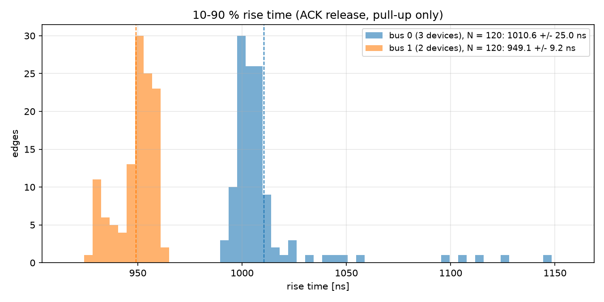
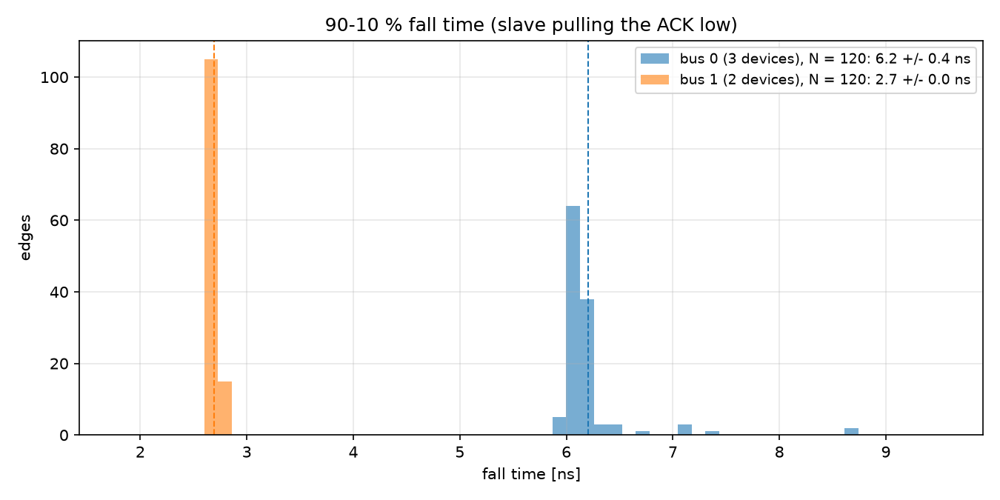

# ECE 437 Midterm — Report 2: The Bus

Name: Tong Li   NetID: tongli5   Lab partner: ______________________  Date of data: 2026-10-26

All numbers in this report come from files in `midterm/results/`, and each answer names its file. The code is
`midterm_p2_python.py`, which is uploaded to Midterm Part 2.

## Method

**Hardware.** I used the Part 1 bit file, with no new firmware. One I²C state machine serves both buses, and
`param1[8]` selects bus 0 or bus 1 for each transaction. The scope marker on PMOD A pin 1 is high for FSM states
110–116. Those states cover the last bit of the read address and its acknowledgment. The marker is generated the
same way whichever bus is selected, so **both buses are triggered on the same event**: CH2 rising at 1.65 V,
NORMAL sweep. A bus check first confirmed that each bus answers and that the select really switches. The ADT7420
read `0xCB` on bus 0 and the LSM303 read `0x88` on bus 1. The LSM303 NACKs on bus 0 and the LPS35HW NACKs on bus 1.

**Scope.** I used an MSO-X 3024T with 10x probes, DC coupling and full bandwidth. The window is 32 µs and the
sample spacing is 0.4 ns (80 000 points). Acquisition is NORMAL, never averaged. CH1 was on SDA_0 for bus 0 and was
then moved to SDA_1 for bus 1. CH2 was on the marker. Both probe grounds were on PMOD GND (pin 5).

**Which edges.** In every read, the slave acknowledges the read address. t = 0 is the marker's rising edge, and
Ts = 2.5 µs is one FSM state.

- **Fall (≈ 4 Ts):** SCL falls and the slave pulls SDA low. The slave's output transistor drives this edge.
- **Rise (≈ 8 Ts):** SCL falls after the ACK clock and the slave releases SDA. Only the 10 kΩ pull-up drives
   this edge.

The rise exists only if data bit 7 is 1. So on each bus I read a register whose bit 7 is 1: ADT7420 ID `0x0B` =
`0xCB` on bus 0, and LSM303 CTRL_REG4_A `0x23` = `0x88` on bus 1. I measured the release edge because on bus 1 the
LSM303 read address `0x33` keeps SDA high through the end of the address, so there is no pull-up rise before
that ACK.

**Edge fit, done in Python from the array (no cursors).**

1. Ts is taken from the marker's width (7 states), checked on every capture to be within 5 % of 2.5 µs.
2. The levels are medians over flat parts of the bit timeline. The ACK-low level is the median over 5–7.9 Ts. The
   high levels are medians over 3–3.95 Ts (before the fall) and 10–11.9 Ts (data bit 7, after the rise).
3. The 10 % and 90 % levels are taken from each edge's own swing. Crossing times are interpolated linearly between
   samples.
4. The rise is smoothed with a 25 ns moving average before the crossings are found. Without it, scope noise on the
   slow part near 90 % makes the crossing about 3 % early. On a synthetic edge with known τ, this recovers the
   rise to within 0.3 %.
5. τ is also fitted as a straight line to ln(Vh − v) between the 10 % and 90 % points, as a cross-check.

A capture is only stored if it fits, and **120 edges per bus** were captured and fitted automatically.
The raw scope codes are kept in `p2_bus0_raw.npz` and `p2_bus1_raw.npz`, so every number can be re-derived
(`analyze` mode).

---

## Question 3: The two buses

### 3a. Rise-time histograms

| (`p2_summary.json`, `p2_edges.csv`) | Bus 0: ADT7420, HTS221, LPS35HW | Bus 1: LSM303, AD7156 |
|---|---|---|
| Edges | 120 | 120 |
| **Rise 10–90 %, mean ± std** | **1010.6 ± 25.0 ns** | **949.1 ± 9.2 ns** |
| **Fall 90–10 %, mean ± std** | **6.20 ± 0.39 ns** | **2.69 ± 0.03 ns** |

The bus 0 distribution has a tail. Its first 10 edges were 1100–1145 ns, captured right after I pressed Enter. The
other 110 sit at about 1000 ns. Without those 10 edges, bus 0 is 1006.2 ± 12.7 ns. I kept all 120 in the
numbers above and discuss the tail in 4d.

The fall is set by the slave's pull-down transistor, not by the bus, which is why it is about 150–350 times faster
than the rise. The bus 1 fall (2.7 ns) undershoots to about −0.9 V and rings (Figure 1). That ringing is the probe
ground lead's inductance. The scope's own rise time is about 0.35 / 350 MHz ≈ 1 ns, so 2.7 ns is an upper bound
on the true fall.

### 3b. Capacitance of each bus

The rise is an RC charge, v(t) = Vh − ΔV·e^(−t/τ). That gives t(10→90 %) = τ·ln 9 = 2.197 τ, and so C = τ / R.
The pull-ups are R4–R7 on the schematic, one per line, each **10.00 kΩ**.

| | Bus 0 | Bus 1 |
|---|---|---|
| τ = t_rise / ln 9 | 459.9 ns | 432.0 ns |
| τ from the log-fit of each edge (cross-check) | 459.0 ns | 430.1 ns |
| **C = τ / 10.00 kΩ** | **46.0 pF** | **43.2 pF** |

**Difference: C(bus 0) − C(bus 1) = 2.8 pF.** Without bus 0's first 10 edges, bus 0 is 45.8 pF and the
difference is 2.6 pF. Both buses include the same 10x probe, and its capacitance cancels in the difference.

The two τ estimates agree within 0.5 %, which confirms that each rise is a single-exponential RC charge.

### 3c. Is the difference consistent with three devices against two?

Bus 0 has one more device than bus 1 and has the larger capacitance, so the sign is right. If each device adds the
same amount, **one device adds about 2.8 pF** (between 2.6 and 2.8 pF, depending on the tail).

**Do the pins alone account for the difference?** Yes. A CMOS I²C input pin is typically a few pF, and the
I²C specification allows up to 10 pF per pin (C_i). 2.8 pF is in that range for one SDA pin with its pad and
ESD structure. One caveat: the LSM303 holds two I²C slaves (accelerometer and magnetometer) but has only one SDA pin.

**Do the pins account for the total?** No, and this is where trace length matters. Model C = C_fixed + n·C_device.
Then C_fixed ≈ 46.0 − 3 × 2.8 ≈ 38 pF on bus 0, and similarly on bus 1. The devices supply less than 10 pF of each
bus's 43–46 pF. The fixed part is:

- the scope probe, about 10–15 pF for a 10x passive probe;
- the FPGA pin, a few pF;
- the board-to-board connector between the XEM7310 and the sensor board;
- the copper traces.

A trace adds roughly 1 pF per cm (a 50 Ω line has C = t_pd / Z₀ ≈ 57 ps/cm / 50 Ω ≈ 1.1 pF/cm). So 10–20 pF of
traces and connector means a route on the order of 10 cm, which is plausible from the FPGA through the connector
to the sensors. Two buses do not give enough data to separate a per-device capacitance from a difference in trace
length between the buses. The 2.8 pF could include a centimetre or two more copper on bus 0. What the data does
show is that a device's pins and the trace lengths are of the same order, a few pF each, and that the trace
length is not negligible.

### 3d. Maximum SCL each bus can support

The I²C specification (NXP UM10204, Table 10) limits the rise time t_r, which it measures from **30 % to 70 %**
of VDD. For an RC edge, t_r(30→70 %) = τ·ln(7/3) = 0.847 τ. I compare that with the limits, not my 10–90 % number,
which uses a different definition.

| (`p2_summary.json`) | t_r (30–70 %) | Fm+ 1 MHz: ≤ 120 ns | Fm 400 kHz: ≤ 300 ns | Sm 100 kHz: ≤ 1000 ns | **Max SCL** |
|---|---|---|---|---|---|
| Bus 0 | 390 ns | no | no | yes | **100 kHz** |
| Bus 1 | 366 ns | no | no | yes | **100 kHz** |

**Compared with the LSM303 datasheet.** Table 6 (p.12) gives f(SCL) up to **400 kHz** (fast mode), with
t_r ≤ 300 ns in fast mode. That disagrees with my 100 kHz.

- **400 kHz describes the chip:** what the LSM303's interface can do if the bus meets the fast-mode rise time.
- **100 kHz describes my board:** 10 kΩ pull-ups on about 45 pF give a 30–70 % rise of 366–390 ns, longer than
   fast mode's 300 ns.

A fast-mode rise on bus 0 would need R ≤ 300 ns / (0.847 × 46 pF) ≈ 7.7 kΩ. On bus 1 it would need about 8.2 kΩ.

### 3e. Two routes to the same limit

**Lab 5 route.** In Lab 5 (`Lab5/lab5_scl.txt`) the ACK was present at 30.94 kHz and still present when doubled
to 61.27 kHz. Lab 5 never reached a frequency where the ACK disappeared. So I repeated that test with the run-time
SCL divide of the midterm design, which can go much faster (`sweep` mode, `p2_scl_sweep.csv`). It does the same
read as in the captures, 100 reads at each step, with SCL from 100 kHz up to the point where the ACK disappears.
On bus 0 this is the same ADT7420 read as in Lab 5.

| | Max SCL from the rise-time limits (3d) | Highest SCL with 100/100 correct reads | ACK disappears (0/100) at |
|---|---|---|---|
| Bus 0 | 100 kHz | 1145 kHz | 1260 kHz |
| Bus 1 | 100 kHz | 1050 kHz | 1145 kHz |

**They disagree by a factor of about 11.** I believe the sweep as the physical failure point. The 100 kHz is not
wrong, but it is a guarantee, not a prediction of failure.

- The specification's rise-time limit is a conformance limit with large margin. At 100 kHz it allows 1 µs of rise
   in a 10 µs period, so that every compliant part works across voltage, temperature and process. A bus that
   exceeds it is not guaranteed, but it does not stop working at that point.
- **The physical limit comes from τ.** My state machine releases SCL for 2 of the 4 states in each bit. The slave
   sees SCL high only once SCL reaches V_IH = 0.7 VDD, which takes τ·ln(1/0.3) = 1.20 τ. Clocking fails when
   2 Ts < 1.20 τ, that is when f_SCL = 1/(4 Ts) > 1/(2.41 τ). With the SDA τ values this predicts **903 kHz**
   (bus 0) and **961 kHz** (bus 1). SCL carries no scope probe, so its τ is probably shorter: with about 10 pF
   less, τ ≈ 360 ns predicts 1.15 MHz on bus 0, which is where it failed.
- So the rise-time physics predicts the observed failure to within about 25 %, well within a factor of two.

The "something else" between 100 kHz and 1.2 MHz is the specification's margin, not a second physical mechanism.
I did not measure SCL directly, and bus 1 failing one step earlier than bus 0, despite its faster SDA, suggests
that SCL_1 is somewhat more loaded than SCL_0.

---

## Question 4: How close to the physics are you?

### 4a. kT/C noise

v_n = √(kT/C) with k = 1.381 × 10⁻²³ J/K and T = 300 K (kT = 4.14 × 10⁻²¹ J):

| | C | v_n = √(kT/C) |
|---|---|---|
| Bus 0 | 46.0 pF | **9.5 µV rms** |
| Bus 1 | 43.2 pF | **9.8 µV rms** |

### 4b. Jitter from the measured slew rate at the logic threshold

The threshold is the 50 % point of the rise (≈ 1.65 V, a CMOS input's switching point). The slew rate is measured
on every captured edge with a straight-line fit over ±20 ns around that crossing, then averaged over the 120
edges. For an RC edge the expected value is (ΔV/2)/τ, which is 3.59 and 3.82 V/µs, close to the measurement.

| | Measured slew at 50 % | Jitter = v_n / slew |
|---|---|---|
| Bus 0 | 3.71 V/µs | **2.6 ps** |
| Bus 1 | 4.00 V/µs | **2.5 ps** |

### 4c. Compared with the measured spread

| | Std of the rise time | Thermal jitter | Ratio |
|---|---|---|---|
| Bus 0 | 25.0 ns (12.7 ns without the first 10) | 2.6 ps | **≈ 9800×** (≈ 5000×) |
| Bus 1 | 9.2 ns | 2.5 ps | **≈ 3800×** |

**The measured spread is larger, by between 3.5 and 4 orders of magnitude.** A more careful thermal floor for a
10–90 % rise does not close the gap. The rise time is the difference of two crossings, and the 90 % crossing
has one-ninth of the 10 % slew, so its jitter is about 13 ps. That still leaves a factor of about 700–2000.

### 4d. What is responsible, and how to isolate it

1. **Scope front-end noise and 8-bit quantization.** On flat stretches of SDA the capture shows **12–13 mV rms**
   (ACK-low level) and 20–22 mV rms (high level). That is about 1300 times v_n. The 8-bit ADC at 0.5 V/div alone
   has a 16 mV step (4.5 mV rms quantization noise). At the 50 % slew, 12 mV corresponds to about 3.3 ns of
   jitter, and at the slower 90 % point it is several times more. Even after the 25 ns smoothing, this alone
   explains most of bus 1's 9 ns spread.
2. **Interference picked up on the bus and the probe's ground loop.** The bumps on SDA at every SCL edge in
   Figure 1 are SCL-to-SDA crosstalk. Switching on the FPGA and USB, and 60 Hz pickup in the probe ground loop,
   shift the baseline and the high level from capture to capture. That moves the 10 % and 90 % levels.
3. **Slow drift of the setup during the run.** The probe and cable were still settling after I pressed Enter,
   which produced the 1100–1145 ns tail of bus 0's first 10 edges. Without them the std halves, from 25.0 to
   12.7 ns. Temperature and supply drift change τ (through R and C) and the 3.3 V level.

**A measurement that isolates effect 1.** Leave the probe on the board and connect its tip to its own ground
spring at PMOD GND, with no signal. Keep the same 0.5 V/div, the same 32 µs window and the same 0.4 ns sampling,
and take 120 NORMAL captures. The rms of those records is the scope's noise alone. Then add each recorded noise
trace to an ideal exponential with τ = 460 ns, and run the same 10–90 % fit on it. The std of the rise times that
comes out is the part of my spread caused by the instrument alone. Whatever is left beyond that is the bus:
interference and drift. Drift (effect 3) can be checked from data I already have by plotting rise time against
capture index: a trend or a step is drift, and white scatter is noise.

---

## Files

| File | What it is |
|---|---|
| `midterm_p2_python.py` | Bus check, capture loop, edge fit, histograms, capacitance, SCL sweep, self-test |
| `results/p2_bus0_raw.npz`, `p2_bus1_raw.npz` | 120 raw SDA and marker captures per bus (scope codes + preamble) |
| `results/p2_edges.csv` | Rise, fall and τ of every edge |
| `results/p2_summary.json` | Means, stds, τ, C, the difference, and max SCL |
| `results/p2_rise_hist.png`, `p2_fall_hist.png`, `p2_edge_per_bus.png` | Figures 1–3 |
| `results/p2_scl_sweep.csv`, `p2_scl_sweep.json` | 3e: reads that ACKed and were correct at each SCL, both buses |
